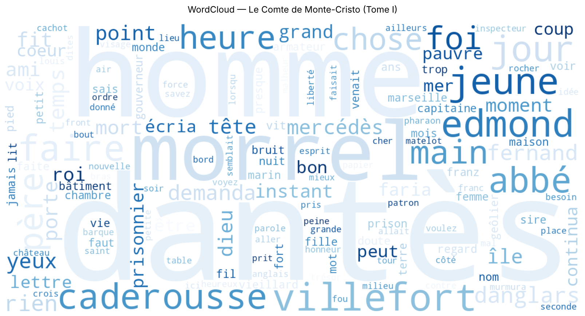
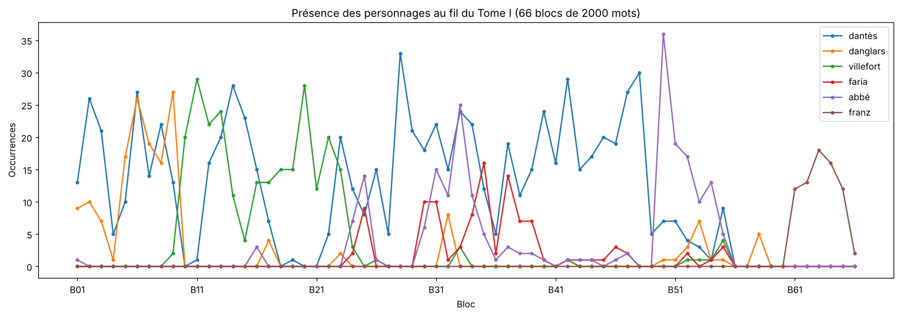

# TP 1 — Introduction au NLP : *Le Comte de Monte-Cristo*

**Master 2 Intelligence Artificielle — Traitement Automatique du Langage Naturel**

Pipeline NLP complet (prétraitement, représentation et analyse) appliqué au **Tome I du *Comte de Monte-Cristo*** d'Alexandre Dumas (Project Gutenberg #17989).

| Livrable | Fichier |
|---|---|
| Notebook exécuté (code + sorties + graphiques) | [`TP1_NLP_Monte_Cristo.ipynb`](TP1_NLP_Monte_Cristo.ipynb) |
| Rapport avec toutes les réponses (Word / PDF) | [`rapport/TP1_NLP_Master2_IA_Reponses.docx`](rapport/TP1_NLP_Master2_IA_Reponses.docx) · [`.pdf`](rapport/TP1_NLP_Master2_IA_Reponses.pdf) |
| Code source du notebook (format script) | [`src/tp1_nlp.py`](src/tp1_nlp.py) |
| Figures | [`figures/`](figures/) |
| Exports (CSV) | [`outputs/`](outputs/) |

## Pipeline

```
Gutenberg → extraction → nettoyage → tokenisation → fréquences / Zipf → stop words
         → WordCloud → stemming (Snowball) → lemmatisation + POS (SpaCy)
         → matrice Document-Terme (BoW) → TF-IDF → similarité cosinus / moteur de recherche
```

## Résultats clés

| Indicateur | Valeur |
|---|---|
| Roman extrait | 727 472 caractères · 121 578 mots (`.split`) · 31 chapitres |
| Tokens NLTK après nettoyage | 130 542 · vocabulaire 11 142 · TTR 0,085 |
| Loi de Zipf | pente log-log **–1,15** (théorie : –1) |
| Hapax | 5 434 = 48,8 % du vocabulaire |
| Suppression des stop words | –61,4 % des tokens |
| Stemming Snowball | –47,7 % du vocabulaire |
| Stemming vs lemmatisation (15 mots) | 1/15 corrects vs **13/15** |
| BoW / TF-IDF | 20 blocs × 300 termes · 54,9 % de zéros (93,7 % sans filtrage) |
| TF-IDF vs BoW | chevauchement des top-5 entre blocs : 0,22 → **0,09** |
| Requête « château if prison dantès » | Bloc_15 = chapitre VIII *Le château d'If* |

<p align="center">
  <br>
  
</p>

## Corrections apportées au code du sujet

1. **Marqueurs Gutenberg** : le fichier réel contient `*** START OF THIS PROJECT GUTENBERG EBOOK LE COMTE DE MONTE-CRISTO, TOME I ***` et non `... EBOOK 17989 ***` → `split(DEBUT)[1]` levait une `IndexError`. Remplacé par une regex robuste.
2. **`clean_text`** : les apostrophes typographiques étaient supprimées *avant* d'être normalisées (étapes 4/5 inversées). Ajout de la gestion des élisions (`l'abbé` → `l abbé`), des mots composés (`monte-cristo` conservé), des inversions (`dit-il`) et des nombres.
3. **`sent_tokenize(roman_clean)`** : sur un texte sans ponctuation, on obtient **une seule phrase** → les WordClouds par personnage auraient été identiques. La segmentation en phrases se fait désormais sur le texte brut.
4. **PROPN** : la détection des noms propres a besoin des majuscules → SpaCy appliqué au texte brut.

## Exécution

```bash
pip install -r requirements.txt
python -m spacy download fr_core_news_sm
jupyter notebook TP1_NLP_Monte_Cristo.ipynb
```

Le corpus est mis en cache dans `data/` (le notebook tente gutenberg.org puis le miroir GitHub du Project Gutenberg si le site est inaccessible). Exécution complète : environ 30 secondes.

Pour régénérer le notebook depuis le script : `jupytext --to ipynb src/tp1_nlp.py -o TP1_NLP_Monte_Cristo.ipynb`.

## Environnement testé

Python 3.13 · NLTK 3.10.4 · SpaCy 3.8 (`fr_core_news_sm` 3.8.0) · scikit-learn 1.9.1 · pandas 3.0.5 · Matplotlib 3.11 · WordCloud 1.9.6

---
*Corpus : Project Gutenberg, domaine public.*
